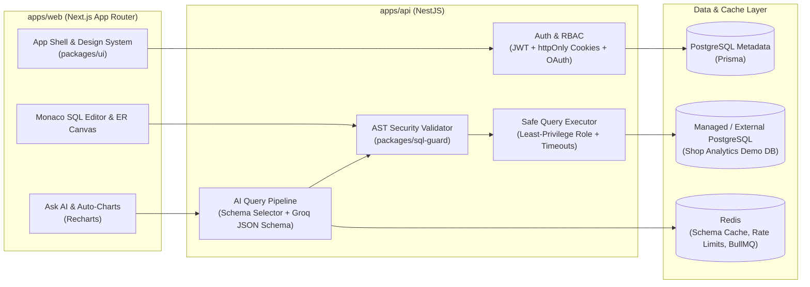

# DataPilot AI — Talk to your database

Multi-tenant SaaS where data teams connect or provision PostgreSQL databases, ask questions in plain English, and receive validated SQL, safe execution results, charts, and plain-English explanations.

---

## Architecture



---

## Repository Structure

```text
datapilot-ai/
├── apps/
│   ├── web/                 # Next.js 15 App Router frontend (Tailwind, shadcn/ui, Monaco, Recharts)
│   └── api/                 # NestJS backend (Prisma, JWT/OAuth, Groq AI, Redis/BullMQ, OpenTelemetry)
├── packages/
│   ├── types/               # Shared strict TypeScript contracts & Zod schemas
│   ├── ui/                  # DataPilot Design System (tokens, fonts, 72 icons, components, themes)
│   └── sql-guard/           # AST-based SQL parser & read-only / destructive query validator
├── datapilot-assets/        # Supplied brand & design system asset pack
├── docker-compose.yml       # Local PostgreSQL (metadata + managed cluster) & Redis
└── turbo.json               # Turborepo task pipeline
```

---

## Quick Start

### 1. Install dependencies
```bash
pnpm install
```

### 2. Configure environment
Copy `.env.example` to `.env`:
```bash
cp .env.example .env
```

### 3. Start infrastructure (Optional — embedded fallback included)
If Docker is installed:
```bash
docker compose up -d
```
> **Note:** If Docker is not running on your machine, `apps/api` automatically boots an embedded persistent PostgreSQL instance (`.data/pglite`) and in-memory Redis cache, pre-seeded with the **Acme Data Team** organization, demo account (`pilot@datapilot.ai`), and **Shop Analytics** database.

### 4. Start development servers
```bash
pnpm dev
```
- **Web App**: http://localhost:3000
- **API Server**: http://localhost:4000/api/v1
- **OpenAPI Docs**: http://localhost:4000/api/docs

